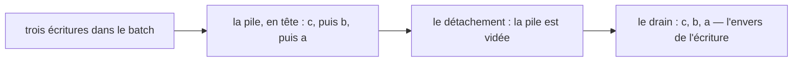

# L'effet et le drainage

Ce qui ordonne vos effets quand une écriture en réveille plusieurs — deux règles distinctes,
rejouées ici code et journal à l'appui. Cette page est une étape du [chapitre de
reconstruction](./index) ; le chapitre rejoue le moteur dans l'ordre où on le réécrirait.

> **Structure :** [`architecture.md`](../architecture.md) — la file, le détachement, la pile.
> **Norme :** [`SPEC.md`](/SPEC.md) — l'ordre y est normatif (§13.4) ; cette page le rejoue,
> elle n'établit rien.

| Vous voulez | Allez à |
| --- | --- |
| voir les deux règles tourner, code et journal | [Les deux règles, rejouées](#les-deux-regles-rejouees) |
| comprendre pourquoi la file se vide à l'envers | [Pourquoi l'ordre s'inverse](#pourquoi-lordre-sinverse) |
| savoir ce qu'une écriture réveille, et ce qu'elle laisse muet | [Ce qu'une écriture réveille](#ce-quune-ecriture-reveille) |
| savoir où lisent les autres | [Les trois lectures](#les-trois-lectures) |

Chaque bloc de code de cette page est une **reconstitution** : un code qui rejoue le mécanisme
vu de l'extérieur, avec le journal que `signalcn` a produit pour lui. Le nom du bloc cite un
test de la suite `signalcn-seul`, rattaché à une entrée de matrice existante — le nom rejoint
les scénarios que cette entrée cite déjà, et aucun compte ne bouge.

## Les deux règles, rejouées

Trois signaux distincts écrits dans un batch sortent **à l'envers** des écritures
([`SPEC.md`](/SPEC.md) §13.4). La reconstitution rejoue les deux côtés : hors batch, puis
dans un batch.

```ts reconstitution/three-writes-drain-reversed
const a = signal(0)
const b = signal(0)
const c = signal(0)

effect(() => log("A tourne", a.value))
effect(() => log("B tourne", b.value))
effect(() => log("C tourne", c.value))

a.value = 1
b.value = 1

batch(() => {
  a.value = 2
  b.value = 2
  c.value = 2
})
```

```text
A tourne 0
B tourne 0
C tourne 0
A tourne 1
B tourne 1
C tourne 2
B tourne 2
A tourne 2
```

Les trois premières lignes sont les tournées de création : un `effect()` s'exécute aussitôt
créé. Puis A et B drainent hors batch, dans l'ordre de création : chaque écriture draine
seule. Le batch écrit trois signaux ; le drain les prend à l'envers — C, B, A
([`SPEC.md`](/SPEC.md) §13.4).

Plusieurs effets sur le **même** signal sortent, eux, dans l'ordre de création
([`SPEC.md`](/SPEC.md) §13.4) :

```ts reconstitution/same-signal-creation-order
const s = signal(0)

effect(() => { s.value; log("d1 lit", s.value) })
effect(() => { s.value; log("d2 lit", s.value) })
effect(() => { s.value; log("d3 lit", s.value) })
effect(() => { s.value; log("d4 lit", s.value) })

s.value = 1
```

```text
d1 lit 0
d2 lit 0
d3 lit 0
d4 lit 0
d1 lit 1
d2 lit 1
d3 lit 1
d4 lit 1
```

La pile n'est pas une règle unique qui domine tout : elle décide pour les écritures d'un
batch, la création décide pour les effets d'un même signal. Les confondre produit un
programme qui passe les tests et échoue en production — c'est ce que
[`regles-de-drainage.md`](../regles-de-drainage.md) ouvre.

## Pourquoi l'ordre s'inverse

La structure est dans [`architecture.md`](../architecture.md) : `batchedEffect` est à la fois
tête de pile et tête de liste chaînée, liées par le champ `_nextBatchedEffect` d'un effet. La
liste chaînée *est* la pile : l'insertion en tête fait sortir le drain dans l'ordre inverse
de l'entrée. Et le drain ne lit pas une pile qu'il modifie : il **se détache** — la pile est
vidée avant la première exécution, et ce que les exécutions écrivent repart en entrée de la
génération suivante, un drain étant fait en largeur.



L'inversion n'est pas un choix isolé : c'est la conséquence directe de l'insertion en tête.
Son effet pratique est la **localité** — quand un effet réveille deux aval, le plus proche
s'exécute immédiatement après son producteur, sans attendre la génération suivante
([`architecture.md`](../architecture.md)).

## Ce qu'une écriture réveille

Un effet qui écrit **une dépendance qu'il lit** se ré-exécute dans le même drainage
([`SPEC.md`](/SPEC.md) §8.4). La reconstitution le rejoue, et montre du même coup pourquoi il
s'arrête : une écriture à valeur identique n'est pas un changement — l'identité stricte
décide ([`SPEC.md`](/SPEC.md) §5.1).

```ts reconstitution/self-write-restarts-in-same-drain
const s = signal(1)

effect(() => {
  const v = s.value
  log("tourne, voit", v)
  if (v < 3) s.value = v + 1
})
```

```text
tourne, voit 1
tourne, voit 2
tourne, voit 3
```

1 devient 2, 2 devient 3 : deux écritures, chacune relance l'effet **dans le même drainage**.
L'arrivée à 3 est écrite, mais la valeur est identique : l'identité coupe la boucle. Sans cette
rigueur, un effet qui réécrit sa propre dépendance tournerait sans fin — c'est ce que l'étape
`Le cycle et la borne` du [chapitre](./index) reconstruit.

## Les trois lectures

La surface de `effect()` et de `batch()` vit sur la référence de l'API, qui donne leurs cas
d'usage ; le chapitre ne donne que le mécanisme — la circulation va de l'API vers ici, jamais
en retour. Le même sujet se lit à trois endroits :

| Lecture | Où |
| --- | --- |
| l'utilisateur veut le programme qui marche | [`premier-effet.md`](../../utilisateurs/premier-effet.md) — une lecture est une promesse |
| le contributeur veut les règles exécutables | [`regles-de-drainage.md`](../regles-de-drainage.md), [`architecture.md`](../architecture.md) |
| l'apprenant veut reproduire | [le chapitre](./index), et cette page |
