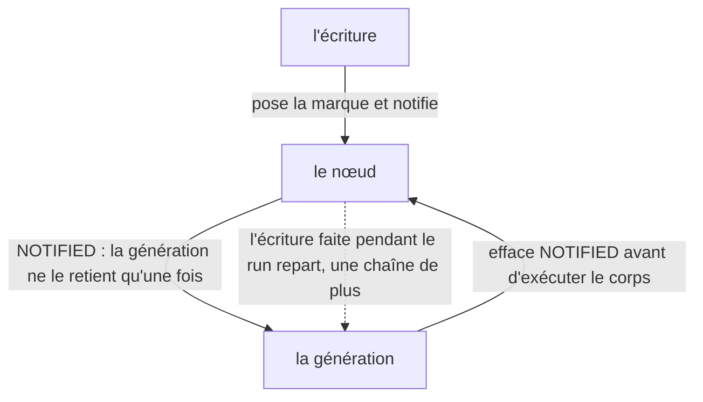

# L'invalidation

Une écriture ne réveille pas le graphe : elle marque, et ce qui n'est pas lu attend ; un nœud
déjà entendu dans la même génération ne s'entend pas deux fois ; et un effet qui écrit ce qu'il
lit repart aussitôt. Trois règles d'un même état — celui d'un nœud qui se réveille et qui se
tait — rejouées ici code et journal à l'appui. Cette page est la troisième étape du
[chapitre de reconstruction](./index) ; le chapitre rejoue le moteur dans l'ordre où on le
réécrirait.

> **Structure :** [`architecture.md`](../architecture.md) — §10, « Les drapeaux » : `OUTDATED`
> et `NOTIFIED`, l'effacement avant l'exécution, et la déduplication dans une génération.
> **Norme :** [`SPEC.md`](/SPEC.md) — l'invalidation d'un computed y est normative (§6), la
> coalescence d'une génération aussi (§9.3), et l'effet qui s'écrit lui-même y repart dans le
> même drainage (§8.4) ; cette page les rejoue, elle n'établit rien.

| Vous voulez | Allez à |
| --- | --- |
| voir trois écritures attendre la lecture | [L'invalidation attend la lecture](#l-invalidation-attend-la-lecture) |
| voir une génération ne réveiller qu'une fois | [La génération ne réveille qu'une fois](#la-generation-ne-reveille-qu-une-fois) |
| voir l'écriture d'un run en réveiller une autre | [L'écriture du run repart](#l-ecriture-du-run-repart) |
| comprendre pourquoi le drapeau s'efface avant l'exécution | [Pourquoi le drapeau s'efface avant l'exécution](#pourquoi-le-drapeau-s-efface-avant-l-execution) |
| savoir où lisent les autres | [Les trois lectures](#les-trois-lectures) |
| voir la place de cette page dans l'ordre du chapitre | [Le chapitre de reconstruction](./index) |

Chaque bloc de code de cette page est une **reconstitution** : le corps d'un test de la
suite `signalcn-seul`, exécuté au moment du rendu contre l'artefact distribué. Le journal
que la page montre est celui de cette exécution — jamais une recopie. Le nom du bloc est le
nom du test, et une entrée de matrice existante le cite à côté des scénarios qu'elle porte
déjà : la couverture ne gagne aucune entrée, et le harnais rejoue le même test contre le
paquet de référence.

## L'invalidation attend la lecture

« Sans abonné, une écriture d'une source **ne réveille rien** ; le recalcul a lieu à la
prochaine lecture », et « invalidation lorsqu'une dépendance change ; recalcul uniquement
lorsque nécessaire » ([`SPEC.md`](/SPEC.md) §6). La reconstitution écrit **trois** fois entre
deux lectures : le compteur d'évaluations dit que la marque attend, et que la lecture, elle,
paie une fois.

```ts reconstitution/invalidation-waits-for-the-read
```

Avant toute lecture, le calcul n'a jamais tourné : le compteur vaut zéro, le computé est
paresseux. La première lecture évalue (`lit 1`) et rend `10`. Viennent les trois écritures :
le compteur reste à **un** — la marque est posée, mais rien ne la paie. La lecture suivante
la trouve et recalcule, une seule fois (`lit 4`) : elle rend `40`, le compteur passe à deux.
La relecture ne repaie pas — `40` est en cache, le compteur reste à deux. Marquer n'est pas
recalculer : la marque attend la lecture.

## La génération ne réveille qu'une fois

« Un effet notifié deux fois ne tourne qu'une fois par drainage » ([`SPEC.md`](/SPEC.md)
§9.3). La reconstitution met un effet sur deux cellules, puis écrit les deux dans un batch —
deux notifications, une génération — et les écrit séparément — deux générations, un tour
chacune.

```ts reconstitution/a-generation-wakes-once
```

La pose fait la première tournée (`0 et 0`). Le batch écrit les deux cellules : l'effet est
notifié deux fois dans la même génération et ne tourne qu'une fois — deuxième tour, qui voit
déjà `1 et 1`. Hors batch, chaque écriture ouvre sa propre génération : celle de la première
cellule fait un tour (`2 et 1`), celle de la seconde un autre (`2 et 2`). Quatre tours en
tout : la génération du batch n'en a coûté qu'un là où deux notifications l'ont traversée.

## L'écriture du run repart

« Un effet qui écrit une dépendance qu'il lit se ré-exécute dans le **même** drainage »
([`SPEC.md`](/SPEC.md) §8.4), et le drain est en largeur : « les effets notifiés pendant
l'exécution repartent dans une nouvelle chaîne ». La reconstitution pose un effet qui monte
`0`, `1`, `2` en s'écrivant lui-même — trois tours à la pose, sans aucune écriture du dehors.
Puis un batch, une écriture identique, une écriture neuve.

```ts reconstitution/the-write-in-the-run-wakes-again
```

À la pose, l'effet lit `0`, écrit `1` et repart ; lit `1`, écrit `2` et repart ; lit `2` et
s'arrête : trois tours, et c'est l'effacement avant l'exécution qui le permet — sinon
l'écriture faite **pendant** le corps trouverait le drapeau posé, et le réveil serait perdu.
Le batch montre la frontière : dans son corps, l'effet n'a pas encore tourné (`tours 3`) ;
à la sortie, la génération draine, l'effet tourne une fois en voyant `5` — une seule, parce
que `5` n'appelle plus d'écriture. La fin sépare les deux écritures du dehors : écrire `5` sur
`5` ne réveille personne — l'identité se tait — quand écrire `7` réveille une fois. Un nœud
qui se réveille se réveille pour de bon : le drapeau est effacé avant son tour.

## Pourquoi le drapeau s'efface avant l'exécution

La structure vit dans [`architecture.md`](../architecture.md) — §10, « Les drapeaux ». Deux
drapeaux racontent la vie du nœud. `OUTDATED` dit « mon cache est peut-être périmé » : il est
posé à la notification et effacé **avant** le recalcul — c'est la marque qui attend la
lecture. `NOTIFIED` dit « je suis déjà dans la génération » : il est posé à la notification,
et effacé avant l'exécution, inconditionnellement. C'est cet effacement qui rouvre le nœud :
un corps qui s'écrit pendant son propre tour retrouve le drapeau baissé, et repart dans une
chaîne de plus. Effacé après l'exécution, il absorberait l'écriture du run. La figure dit les
gestes que la page a rejoués — la marque qui attend, la génération qui retient, l'effacement
qui rouvre :



Le graphe vivant (chaîne, diamant, dépendance dynamique) est dessiné dans
[`graphe-de-dependances.md`](../graphe-de-dependances.md) ; cette page rejoue les règles,
la figure ne les vérifie pas.

## Les trois lectures

La référence de l'API donne les cas d'usage de l'invalidation ; le chapitre ne donne que le
mécanisme — la circulation va de l'API vers ici, jamais en retour. Le même sujet se lit à
trois endroits :

| Lecture | Où |
| --- | --- |
| l'utilisateur veut le programme qui marche | [`batch-et-surprises.md`](../../utilisateurs/batch-et-surprises.md) — la coalescence et l'effet qui s'écrit soi-même y sont les deux surprises |
| le contributeur veut les règles exécutables | [`regles-de-drainage.md`](../regles-de-drainage.md), [`architecture.md`](../architecture.md) §10 |
| l'apprenant veut reproduire | [le chapitre](./index), et cette page |
