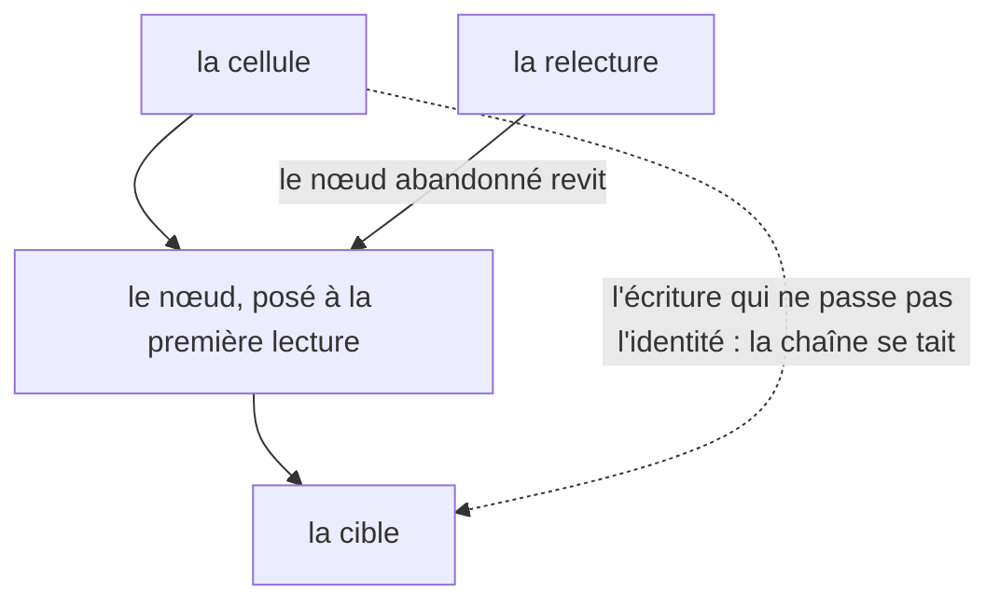

# La cellule et le nœud

Il faut trois règles pour lire le reste du graphe : ce qui décide qu'une écriture se tait,
ce qui décide qu'elle réveille, et quelle cible l'entend — trois règles distinctes, rejouées
ici code et journal à l'appui. Cette page est la première étape du
[chapitre de reconstruction](./index) ; le chapitre rejoue le moteur dans l'ordre où on le
réécrirait.

> **Structure :** [`architecture.md`](../architecture.md) — la cellule (`Signal`), la liste
> de ses cibles, et le nœud qu'une réactivation ne réalloue pas.
> **Norme :** [`SPEC.md`](/SPEC.md) — l'identité qui décide d'une écriture y est normative
> (§5.2), la notification qu'elle porte aussi (§5.1), et la dépendance qu'une relecture
> redonne (§7) ; cette page les rejoue, elle n'établit rien.

| Vous voulez | Allez à |
| --- | --- |
| voir quand une écriture se tait et quand elle passe | [Les écritures que l'identité refuse](#les-ecritures-que-l-identite-refuse) |
| voir une dépendance abandonnée redevenir notifiante | [La dépendance abandonnée revit](#la-dependance-abandonnee-revit) |
| voir une écriture réveiller toutes ses cibles | [Une écriture, toutes les cibles](#une-ecriture-toutes-les-cibles) |
| comprendre pourquoi le nœud ne se réalloue pas | [Pourquoi le nœud ne se réalloue pas](#pourquoi-le-noœud-ne-se-realloue-pas) |
| savoir où lisent les autres | [Les trois lectures](#les-trois-lectures) |
| voir la place de cette page dans l'ordre du chapitre | [Le chapitre de reconstruction](./index) |

Chaque bloc de code de cette page est une **reconstitution** : le corps d'un test de la
suite `signalcn-seul`, exécuté au moment du rendu contre l'artefact distribué. Le journal
que la page montre est celui de cette exécution — jamais une recopie. Le nom du bloc est le
nom du test, et une entrée de matrice existante le cite à côté des scénarios qu'elle porte
déjà : la couverture ne gagne aucune entrée, et le harnais rejoue le même test contre le
paquet de référence.

## Les écritures que l'identité refuse

Une écriture modifie le signal et propage l'invalidation « si la sémantique d'égalité le
déclenche » ([`SPEC.md`](/SPEC.md) §5.1) — et cette sémantique est une **identité stricte
`!==`**, pas une identité de valeur ([`SPEC.md`](/SPEC.md) §5.2). La reconstitution fait
compter les tournées à deux cellules attentives : la première écoute une écriture neuve, la
même primitive écrite deux fois et `NaN` appliqué à `NaN` ; la seconde écoute `0`, puis un
`-0`.

```ts reconstitution/identical-writes-are-not-notified
```

La première ligne est la tournée de création : l'effet s'exécute aussitôt posé, sans
attendre d'écriture. Puis les écritures partagent le même fil : la primitive identique laisse
le compte à deux, `NaN` passe **deux** fois parce que `NaN !== NaN` est vrai, et le `-0`
n'arrive à rien — la seconde cellule a tourné une fois, sa création, et `Object.is` dit que
la valeur est restée `0`. Le silence d'une écriture n'est pas une perte : une valeur qui
n'a pas changé n'a rien à dire.

## La dépendance abandonnée revit

La SPEC §7 dit la moitié logique : `a` ne doit plus invalider `value` tant que `enabled`
vaut `false` — et dit l'autre moitié dans son dernier paragraphe : si `enabled` repasse à
`true`, `a` **redevient notifiant**, et le nœud abandonné est réutilisé, pas recréé. Le
scénario de la table rejoue cette règle côté dérivation ; la reconstitution la rejoue côté
effet, qui marche pareil ([`SPEC.md`](/SPEC.md) §7). Une écriture tombée pendant
l'abandon s'y voit : le compte de tours ne bouge pas à son passage, et la relecture
l'intègre.

```ts reconstitution/reread-wakes-dependency
```

L'effet tourne une fois à la création (`1`), puis à la bascule (`2`), qui abandonne la
dépendance gauche. L'écriture de `10` sur la cellule abandonnée ne fait **rien** — le
compte reste à deux : le nœud ne porte plus l'écriture vers lui. La relecture fait tourner
une troisième fois, et la valeur lue est `10` : l'écriture entre les deux lectures
s'intègre. Enfin `11` réveille, parce que le nœud a **revécu** à la relecture — quatrième
tour, et pas un de plus.

## Une écriture, toutes les cibles

L'invalidation que §5.1 promet quand l'identité passe n'a pas de cible privilégiée : chaque
cible que la cellule connaît entend l'écriture, chacune une fois, et pas plus. Deux effets
sur la même cellule le montrent ([`SPEC.md`](/SPEC.md) §5.1) ; l'ordre des tournées est le
sujet d'une page suivante du chapitre, la reconstitution ne le joue pas.

```ts reconstitution/write-wakes-every-target
```

Deux tournées de création, puis deux tournées à l'écriture — quatre lignes, le total dont
la page a besoin : les deux cibles ont tourné **une** fois chacune. Une écriture n'est pas
un gâchis de tours ; l'ordre de ces tournées, et le garde-fou de la borne, appartiennent à
des pages suivantes du chapitre.

## Pourquoi le nœud ne se réalloue pas

La structure vit dans [`architecture.md`](../architecture.md) : la cellule porte une liste
de cibles, et le nœud porte la chaîne qui relie le graphe. La figure dit les trois gestes
que la page a rejoués — la lecture qui pose, l'écriture identique qui se tait, la relecture
qui fait vivre :



Le graphe vivant (chaîne, diamant, dépendance dynamique) est dessiné dans
[`graphe-de-dependances.md`](../graphe-de-dependances.md) ; cette page rejoue les règles,
la figure ne les vérifie pas.

## Les trois lectures

La surface de `signal()` vit sur la référence de l'API, qui donne ses cas d'usage ; le
chapitre ne donne que le mécanisme — la circulation va de l'API vers ici, jamais en
retour. Le même sujet se lit à trois endroits :

| Lecture | Où |
| --- | --- |
| l'utilisateur veut le programme qui marche | [`premier-effet.md`](../../utilisateurs/premier-effet.md) — une écriture est ici sous condition |
| le contributeur veut les règles exécutables | [`regles-de-drainage.md`](../regles-de-drainage.md), [`architecture.md`](../architecture.md) |
| l'apprenant veut reproduire | [le chapitre](./index), et cette page |
