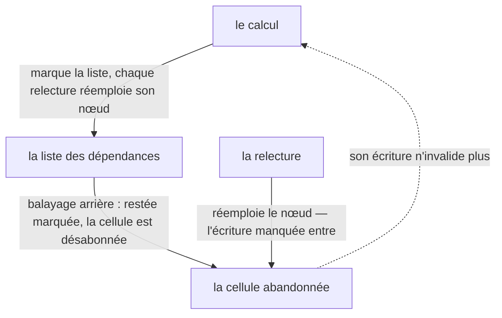

# La dépendance

La liste des dépendances n'est jamais acquise : un calcul ne garde que ce qu'il a lu lors de
son exécution courante, une cellule non relue se défait, une relecture la refait — la même
règle, vue par ses trois bouts. Cette page est la deuxième étape du
[chapitre de reconstruction](./index) ; le chapitre rejoue le moteur dans l'ordre où on le
réécrirait.

> **Structure :** [`architecture.md`](../architecture.md) — la réconciliation des dépendances,
> et pourquoi un nœud abandonné se réemploie au lieu de se recréer.
> **Norme :** [`SPEC.md`](/SPEC.md) — la collecte qui suit la dernière lecture y est normative
> (§7), l'abandon et la relecture aussi ; cette page les rejoue, elle n'établit rien.

| Vous voulez | Allez à |
| --- | --- |
| voir la liste suivre la dernière lecture | [La liste suit la dernière lecture](#la-liste-suit-la-derniere-lecture) |
| voir une cellule abandonnée cesser de faire recalculer | [L'abandon saute le recalcul](#l-abandon-saute-le-recalcul) |
| voir la relecture ranimer l'abandonnée | [La relecture ranime l'abandonnée](#la-relecture-ranime-l-abandonnee) |
| comprendre pourquoi la liste se défait et se refait | [Pourquoi la liste se défait et se refait](#pourquoi-la-liste-se-defait-et-se-refait) |
| savoir où lisent les autres | [Les trois lectures](#les-trois-lectures) |
| voir la place de cette page dans l'ordre du chapitre | [Le chapitre de reconstruction](./index) |

Chaque bloc de code de cette page est une **reconstitution** : le corps d'un test de la
suite `signalcn-seul`, exécuté au moment du rendu contre l'artefact distribué. Le journal
que la page montre est celui de cette exécution — jamais une recopie. Le nom du bloc est le
nom du test, et une entrée de matrice existante le cite à côté des scénarios qu'elle porte
déjà : la couverture ne gagne aucune entrée, et le harnais rejoue le même test contre le
paquet de référence.

## La liste suit la dernière lecture

Une dérivation « ne conserve que ses dépendances effectivement lues lors de son exécution
courante » ([`SPEC.md`](/SPEC.md) §7) — et le §7 dit dans le même souffle que « ce
comportement s'applique aussi aux effects ». La reconstitution le montre côté effet, avec
deux cellules derrière une bascule : l'effet lit l'une ou l'autre, jamais les deux.

```ts reconstitution/dependencies-follow-the-current-read
```

L'effet tourne une fois à la pose et lit `1` ; l'écriture de la cellule que la bascule tient
en réserve ne le réveille pas — le compte reste à un, cette cellule n'a jamais été lue. La
bascule change la lecture : le tour suivant lit `20`, la valeur écrite pendant la réserve.
Puis l'écriture de l'ancienne cellule ne fait plus rien — c'est elle, maintenant,
l'abandonnée — tandis que celle de la cellule lue réveille, troisième tour. La liste a suivi
la lecture, dans les deux sens.

## L'abandon saute le recalcul

« Après un passage à `enabled === false`, `a` ne doit plus provoquer d'invalidation de
`value` s'il n'est plus lu » ([`SPEC.md`](/SPEC.md) §7) ; le §6 le redit côté dérivation :
« invalidation lorsqu'une dépendance change ; recalcul uniquement lorsque nécessaire ». La
reconstitution compte les évaluations : une écriture sur l'abandonnée doit passer inaperçue,
et le compteur le prouve — la valeur seule ne prouverait rien, puisque le résultat serait le
même si le calcul avait repris.

```ts reconstitution/abandoned-dependency-skips-the-recompute
```

La première lecture évalue (`a:1`). La bascule fait repartir le calcul à la lecture suivante
(`b:2`) — un vrai recalcul, la lecture a changé de cellule. Vient l'écriture de `a` : la
troisième lecture rend `b:2` sans qu'aucune ligne « le calcul lit » ne s'intercale, et le
compte des évaluations reste à deux — l'écriture sur l'abandonnée n'invalide même pas le
cache. L'écriture de `b` en revanche réveille : le calcul repart (`b:21`), quatrième
lecture, troisième évaluation.

## La relecture ranime l'abandonnée

« Si `enabled` repasse à `true`, `a` **redevient notifiant** » ([`SPEC.md`](/SPEC.md) §7),
et « le nœud de dépendance abandonné est **réutilisé** à la réactivation, pas recréé ». La
reconstitution rejoue le retour de bout en bout, deux fois : l'écriture tombée pendant
l'abandon doit entrer à la relecture, et la cellule revenue doit de nouveau réveiller le
calcul.

```ts reconstitution/reread-revives-the-abandoned-dependency
```

Le premier cycle : la lecture vaut `1`, la bascule l'abandonne, et l'écriture de `10`
pendant l'abandon reste invisible. Au retour, la lecture rend `10` — l'écriture manquée est
entrée — et le compteur passe à trois : le calcul a bien reparti à la relecture. L'écriture
suivante (`11`) réveille : la cellule revenue notifie de nouveau, et le compteur suit. Le
second cycle refait chaque geste et rend le même verdict aux valeurs du moment (`12`) — le
comportement est une règle, pas un premier tour heureux.

## Pourquoi la liste se défait et se refait

La structure vit dans [`architecture.md`](../architecture.md) — §9, « **marquer, balayer,
réemployer** ». À l'entrée d'un calcul, tous les nœuds de la liste sont marqués ; chaque
relecture réemploie le sien, et le balayage remonte ensuite le chaînage **à l'envers** pour
désabonner et décrocher ce qui est resté marqué — jamais pendant qu'une boucle le suit. Le
réemploi vient de là : la cellule relue retrouve son nœud, elle n'en fait pas naître un
autre — « réutilisé, pas recréé », dit le §7. La figure dit les gestes que la page a
rejoués — la marque, le balayage, le retour :



Le graphe vivant (chaîne, diamant, dépendance dynamique) est dessiné dans
[`graphe-de-dependances.md`](../graphe-de-dependances.md) ; cette page rejoue les règles,
la figure ne les vérifie pas.

## Les trois lectures

La référence de l'API donne les cas d'usage de la collecte des dépendances ; le chapitre ne
donne que le mécanisme — la circulation va de l'API vers ici, jamais en retour. Le même
sujet se lit à trois endroits :

| Lecture | Où |
| --- | --- |
| l'utilisateur veut le programme qui marche | [`premier-effet.md`](../../utilisateurs/premier-effet.md) — la lecture conditionnelle y est le cas qui surprend |
| le contributeur veut les règles exécutables | [`graphe-de-dependances.md`](../graphe-de-dependances.md), [`architecture.md`](../architecture.md) §9 |
| l'apprenant veut reproduire | [le chapitre](./index), et cette page |
