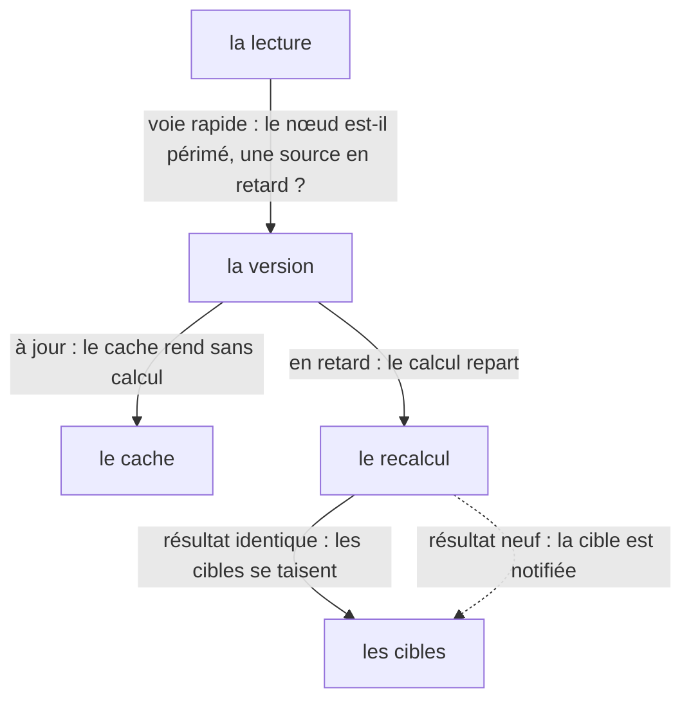

# Le computé

Un computé ne calcule que lorsqu'on le lit, ne recalcule que si une source a bougé, et ne
réveille ses cibles que si le résultat a changé — trois silences d'une même valeur tenue en
cache. Cette page est la quatrième étape du [chapitre de reconstruction](./index) ; le chapitre
rejoue le moteur dans l'ordre où on le réécrirait.

> **Structure :** [`architecture.md`](../architecture.md) — §4, « Le compteur global » : le
> cache, la version, et la voie rapide qui décide de recalculer.
> **Norme :** [`SPEC.md`](/SPEC.md) — la mise en cache, la péremption et la réconciliation du
> résultat y sont normatives (§6) ; la réconciliation des dépendances (§7) et celle du batch
> (§13.5) en sont les voisines ; cette page les rejoue, elle n'établit rien.

| Vous voulez | Allez à |
| --- | --- |
| voir une valeur tenue en cache | [Le cache tient trois lectures](#le-cache-tient-trois-lectures) |
| voir une écriture étrangère laisser le cache intact | [La péremption suit les sources](#la-peremption-suit-les-sources) |
| voir un résultat identique ne réveiller personne | [Le résultat identique se tait](#le-resultat-identique-se-tait) |
| comprendre pourquoi la version et l'identité suffisent | [Pourquoi la version et l'identité suffisent](#pourquoi-la-version-et-l-identite-suffisent) |
| savoir où lisent les autres | [Les trois lectures](#les-trois-lectures) |
| voir la place de cette page dans l'ordre du chapitre | [Le chapitre de reconstruction](./index) |

Chaque bloc de code de cette page est une **reconstitution** : le corps d'un test de la
suite `signalcn-seul`, exécuté au moment du rendu contre l'artefact distribué. Le journal
que la page montre est celui de cette exécution — jamais une recopie. Le nom du bloc est le
nom du test, et une entrée de matrice existante le cite à côté des scénarios qu'elle porte
déjà : la couverture ne gagne aucune entrée, et le harnais rejoue le même test contre le
paquet de référence.

## Le cache tient trois lectures

« Évaluation paresseuse : rien ne s'exécute avant la première lecture », et « mise en cache
tant que le résultat est identique par identité stricte — trois lectures consécutives donnent
**une** évaluation » ([`SPEC.md`](/SPEC.md) §6). La reconstitution lit trois fois de suite,
puis écrit sur la source la valeur qu'elle portait déjà.

```ts reconstitution/three-reads-one-evaluation
```

Le compteur part à zéro : le computé est paresseux. La première lecture évalue (`le calcul lit
1`) et paie une fois ; les deux suivantes rendent `10` sans repasser par le corps, et le
compteur reste à un. L'écriture de `1` sur `1` est refusée par l'identité — la source n'a pas
bougé — et la quatrième lecture est servie par le même cache. Trois lectures, une évaluation :
le cache tient tant que rien ne change.

## La péremption suit les sources

« Sans abonné, une écriture d'une source **ne réveille rien** ; le recalcul a lieu à la
prochaine lecture », et « invalidation lorsqu'une dépendance change ; recalcul uniquement
lorsque nécessaire » ([`SPEC.md`](/SPEC.md) §6). La reconstitution écrit sur une cellule que le
calcul ne lit pas, puis sur sa source.

```ts reconstitution/unlinked-write-is-ignored
```

Les deux écritures étrangères font avancer le compteur global, mais pas la version des sources
lues : la relecture rend `2` et le compte reste à un. L'écriture de `10` sur la source, elle,
expire le cache — le compteur ne bouge pourtant pas avant la lecture, parce que la marque
attend. La lecture suivante repaie une fois (`11`, évaluations deux), et la dernière relecture
ne repaie pas. La péremption suit les sources, jamais les écritures du programme.

## Le résultat identique se tait

Le §6 tient le cache « tant que le résultat est identique par identité stricte » ; une
écriture ne propage l'invalidation que « si la sémantique d'égalité le déclenche »
([`SPEC.md`](/SPEC.md) §5.1). La reconstitution met un effet derrière un computé qui rend une
parité : deux écritures gardent le même résultat, la troisième le change.

```ts reconstitution/identical-result-is-not-notified
```

À la pose, l'effet lit `0`, une évaluation et un tour. L'écriture de `4` fait repartir le
calcul — évaluations deux — mais rend encore `0` : l'effet est notifié puis sauté, et son
compteur reste à un. L'écriture de `3` change la parité : le calcul repart (évaluations trois),
le résultat `1` est neuf, et l'effet tourne (tours deux). Le retour à `5` rend encore `1` :
évaluations quatre, tours deux — le résultat identique s'est tu. Relire ne recalcule pas.

## Pourquoi la version et l'identité suffisent

La structure vit dans [`architecture.md`](../architecture.md) — §4, « Le compteur global ».
Deux sorties successives décident de la lecture : si le nœud n'est pas signalé périmé et
qu'aucune source n'est en retard, le cache rend sans calculer ; sinon, si le compteur global
n'a pas bougé, rien n'a pu changer. Le compteur est **délibérément trop large** — toute
écriture l'avance, même étrangère — et c'est le bon échange : au pire un recalcul inutile,
jamais une valeur fausse. Quand le calcul repart, le résultat est comparé au précédent par
identité stricte : identique, les cibles se taisent ; neuf, elles sont notifiées. La figure dit
les gestes que la page a rejoués — la lecture, la version, le résultat :



Le graphe vivant (chaîne, diamant, dépendance dynamique) est dessiné dans
[`graphe-de-dependances.md`](../graphe-de-dependances.md) ; cette page rejoue les règles,
la figure ne les vérifie pas.

## Les trois lectures

La référence de l'API donne les cas d'usage du computé ; le chapitre ne donne que le
mécanisme — la circulation va de l'API vers ici, jamais en retour. Le même sujet se lit à
trois endroits :

| Lecture | Où |
| --- | --- |
| l'utilisateur veut le programme qui marche | [`computed.md`](../../utilisateurs/api/computed.md) — le dérivé paresseux et son cache y sont la page d'API |
| le contributeur veut les règles exécutables | [`architecture.md`](../architecture.md) §4, [`regles-de-drainage.md`](../regles-de-drainage.md) |
| l'apprenant veut reproduire | [le chapitre](./index), et cette page |
